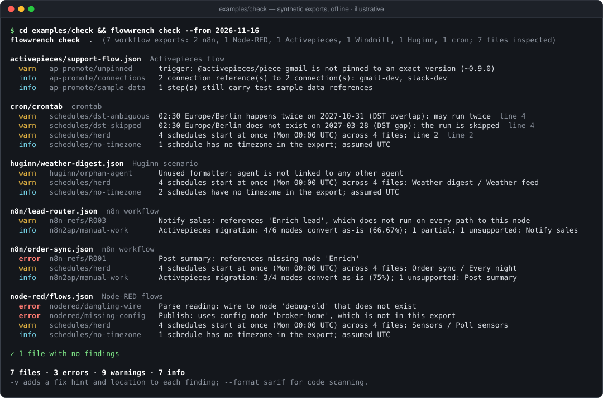

<p align="center">
  <picture>
    <source media="(prefers-color-scheme: dark)" srcset="assets/logo-dark.svg">
    
  </picture>
</p>

<p align="center">
  <strong>Catch broken references, risky schedules and failed migrations in your workflow exports before they hit production.</strong><br>
  One offline CLI for n8n, Node-RED, Activepieces, Windmill, Huginn and cron.
</p>

<p align="center">
  <a href="https://github.com/tianhaogutum/flowwrench/actions/workflows/ci.yml"></a>
  <a href="https://pypi.org/project/flowwrench/"></a>
  <a href="pyproject.toml"></a>
  <a href="LICENSE"></a>
</p>

<p align="center">
  English · <a href="README.zh-CN.md">简体中文</a>
</p>

<p align="center">
  <strong>Point it at the folder you export workflows to. 8 checks across 5 platforms and cron, one report, nothing executed.</strong>
</p>

```sh
uvx flowwrench check .          # or: pipx install flowwrench
```

<p align="center">
  
</p>
<p align="center"><sub>Illustrative: drawn in the exact output format of <code>flowwrench check</code> on the synthetic exports in <a href="examples/check/"><code>examples/check</code></a>. The key lines are pinned by <a href="tests/check/test_cli.py"><code>tests/check/test_cli.py</code></a>.</sub></p>

## Quick start

```sh
uvx flowwrench check .                                  # scan the current folder (read-only)
uvx flowwrench check exports/ --format sarif > fw.sarif # SARIF 2.1.0 for GitHub code scanning
uvx flowwrench check . --fail-on warning                # exit 1 on warnings too, for CI
```

No account, no API key, no running instance, no config. `check` finds exports by their content (an n8n workflow, a Node-RED `flows.json`, an Activepieces flow, a Windmill OpenFlow, a Huginn scenario, a crontab), so you can point it at a whole repository.

> **Not on PyPI yet.** Until the first release, install from Git:
> `pipx install git+https://github.com/tianhaogutum/flowwrench` or
> `uvx --from git+https://github.com/tianhaogutum/flowwrench flowwrench check .`
> (Python 3.11+, Linux and macOS.)

Try it on the demo exports from a clone:

```sh
git clone https://github.com/tianhaogutum/flowwrench && cd flowwrench/examples/check
uvx --from ../.. flowwrench check --from 2026-11-16
```

## Before and after

| You did this | Without flowwrench | `flowwrench check` says |
| --- | --- | --- |
| Renamed an n8n node | `$('Enrich')` fails on the next run, at 1 a.m. | `error n8n-refs/R001 Post summary: references missing node 'Enrich'` |
| Merged two branches of `flows.json` | A wire points at a node that no longer exists | `error nodered/dangling-wire` with the node and port |
| Scheduled "nightly" jobs in n8n, Node-RED, Huginn and cron | They all start at 00:00 UTC and hit the same database | `warn schedules/herd 4 schedules start at once ... across 4 files` |
| Put a report at 02:30 Europe/Berlin | It silently skips a day in March and may run twice in October | `warn schedules/dst-skipped` / `dst-ambiguous` with the dates |
| Exported an Activepieces flow for production | It still points at dev connections, piece versions float | connection inventory, `warn ap-promote/unpinned` |
| Edited a Huginn scenario by hand | An agent is linked to nothing, a schedule name is misspelt | `warn huginn/orphan-agent`, `error huginn/unknown-schedule` |

## What `check` runs

Each check calls the read-only Python API of one flowwrench command; nothing is reimplemented, nothing is written. `flowwrench check --list-checks` prints the list. Details, rule ids and the JSON schema: [docs/check.md](docs/check.md).

| Check | Platform | Finds | Built on |
| --- | --- | --- | --- |
| `n8n-refs` | n8n | References to missing, disabled, downstream or not-always-run nodes; duplicate names; dangling connections | [`n8n-refs`](docs/n8n-refs.md) |
| `n8n2ap` | n8n | How much of each workflow converts to Activepieces as-is (info) | [`n8n2ap`](docs/n8n2ap.md) |
| `nodered` | Node-RED | Wires to missing nodes, missing config/tab/subflow/group nodes | [`nodered-merge`](docs/nodered-merge.md) |
| `ap-promote` | Activepieces | Connections to remap, unpinned piece versions, leftover sample data | [`ap-promote`](docs/ap-promote.md) |
| `windmill` | Windmill | OpenFlow structure, ids, transforms, loops | [`windmill-dryrun`](docs/windmill-dryrun.md) |
| `huginn` | Huginn | Invalid scenarios, dangling links, unknown schedules, cycles, orphan agents | [`huginn`](docs/huginn.md) |
| `schedules` | all + cron | Simultaneous-start herds across files, DST-skipped and doubled runs | [`schedules`](docs/schedules.md) |
| `parse` | all | Exports that do not parse | |

Output is a compact report grouped by file (`--format text`), a stable JSON document (`--format json`, `flowwrench.check/v1`) or SARIF 2.1.0 (`--format sarif`). Exit 0 when clean, 1 when a finding reaches `--fail-on` (default `error`), 2 on usage errors. A check that crashes becomes one `internal` finding; the others still run.

### In CI

```yaml
- run: uvx flowwrench check exports/ --format sarif > flowwrench.sarif || true
- uses: github/codeql-action/upload-sarif@v3
  with:
    sarif_file: flowwrench.sarif
```

## Then fix it: the commands behind the checks

`check` tells you what is wrong. These commands, all in the same install, do the work. Every one is offline.

| Platform | Command | What it does | Docs |
| --- | --- | --- | --- |
| n8n | `n8n-refs` | Check data references between nodes (SARIF for CI) and rename nodes safely | [docs](docs/n8n-refs.md) |
| | `n8n2ap` | Convert an n8n workflow export into an Activepieces flow, with a migration report | [docs](docs/n8n2ap.md) |
| | `n8n-diet` | Measure n8n SQLite execution storage, simulate pruning, reclaim a verified compact copy | [docs](docs/n8n-diet.md) |
| Node-RED | `nodered-merge` | Semantic diff and three-way Git merge driver for `flows.json` | [docs](docs/nodered-merge.md) |
| | `nodered-test` | Headless tests against real Node-RED flow exports (Node.js companion) | [docs](docs/nodered-test.md) |
| Activepieces | `ap-promote` | Inventory, remap and pre-check connections when promoting flows | [docs](docs/ap-promote.md) |
| | `openapi2piece` | Generate an editable Activepieces piece from an OpenAPI 3.0/3.1 file | [docs](docs/openapi2piece.md) |
| Windmill | `windmill-dryrun` | Dry-run OpenFlow mappings and control flow offline against mocks | [docs](docs/windmill-dryrun.md) |
| Huginn | `huginn` | Split, render, diff, lint and combine scenarios as git-friendly YAML | [docs](docs/huginn.md) |
| Schedules | `schedules` | Inventory schedules across platforms and cron; herds, DST hazards, jitter plans | [docs](docs/schedules.md) |

```sh
flowwrench n8n-refs rename workflow.json --from "Enrich" --to "Enrich customer" --dry-run
flowwrench schedules suggest exports/ --max-shift 10m        # read-only jitter plan
flowwrench nodered-merge install                             # plan a Git merge driver for flows.json
```

`flowwrench <command> --help` lists every subcommand and option.

## Trust and limits

- **Offline, no telemetry.** flowwrench opens no network connections and never contacts your n8n, Node-RED, Activepieces, Windmill or Huginn instance.
- **Read-only by default.** `check` and the analysis subcommands never modify inputs. Commands that write need an explicit output path or flag, and most have `--dry-run`.
- **Nothing is executed.** Workflow steps, scripts and cron commands are never run. The exceptions are explicit: `windmill-dryrun` evaluates JavaScript expressions in a sandboxed Node.js child process, and `nodered-test` runs flows on a real Node-RED runtime you install.
- **No secrets in reports.** Findings name nodes and fields, not parameter values or credentials.
- **Exports, not instances.** `check` cannot see which nodes are installed or which credentials exist in the target; timezones missing from an export are assumed (`--default-timezone`, default UTC) and reported.
- **Tested.** 1,400+ Python test functions (`grep -r "def test_" tests | wc -l`); CI on Python 3.11 to 3.14 on Linux, plus macOS. Apache-2.0.

flowwrench is independent and not affiliated with n8n, Node-RED / OpenJS Foundation, Activepieces, Windmill or Huginn. See [THIRD_PARTY.md](THIRD_PARTY.md).

---

<p align="center">If flowwrench caught something before your workflows did, a star helps other people find it.</p>
