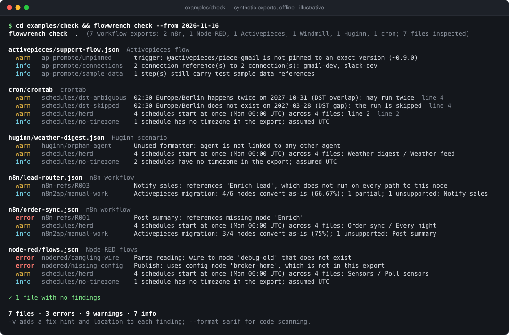

<p align="center">
  <picture>
    <source media="(prefers-color-scheme: dark)" srcset="assets/logo-dark.svg">
    
  </picture>
</p>

<p align="center">
  <strong>在工作流上线之前，找出导出文件里失效的引用、有风险的定时任务和迁移不过去的节点。</strong><br>
  一个离线 CLI，覆盖 n8n、Node-RED、Activepieces、Windmill、Huginn 和 cron。
</p>

<p align="center">
  <a href="https://github.com/tianhaogutum/flowwrench/actions/workflows/ci.yml"></a>
  <a href="https://pypi.org/project/flowwrench/"></a>
  <a href="pyproject.toml"></a>
  <a href="LICENSE"></a>
</p>

<p align="center">
  <a href="README.md">English</a> · 简体中文
</p>

<p align="center">
  <strong>指向你存放导出文件的目录即可：8 项检查，覆盖 5 个平台和 cron，一份报告，不执行任何东西。</strong>
</p>

```sh
uvx flowwrench check .          # 或：pipx install flowwrench
```

<p align="center">
  
</p>
<p align="center"><sub>示意图：按 <code>flowwrench check</code> 的真实输出格式绘制，输入是 <a href="examples/check/"><code>examples/check</code></a> 里的合成导出文件。关键行由 <a href="tests/check/test_cli.py"><code>tests/check/test_cli.py</code></a> 固定。</sub></p>

## 快速开始

```sh
uvx flowwrench check .                                  # 扫描当前目录（只读）
uvx flowwrench check exports/ --format sarif > fw.sarif # SARIF 2.1.0，可上传到 GitHub 代码扫描
uvx flowwrench check . --fail-on warning                # 有警告也返回 1，适合 CI
```

不需要账号、API 密钥、运行中的实例或配置文件。`check` 按**内容**识别导出文件（n8n 工作流、Node-RED `flows.json`、Activepieces 流程、Windmill OpenFlow、Huginn 场景、crontab），所以可以直接扫描整个仓库。

> **尚未发布到 PyPI。** 首个版本发布之前，请从 Git 安装：
> `pipx install git+https://github.com/tianhaogutum/flowwrench` 或
> `uvx --from git+https://github.com/tianhaogutum/flowwrench flowwrench check .`
> （Python 3.11+，Linux 和 macOS。）

克隆仓库后可以在演示数据上试用：

```sh
git clone https://github.com/tianhaogutum/flowwrench && cd flowwrench/examples/check
uvx --from ../.. flowwrench check --from 2026-11-16
```

## 用之前 / 用之后

| 你做了什么 | 没有 flowwrench | `flowwrench check` 的提示 |
| --- | --- | --- |
| 重命名了一个 n8n 节点 | `$('Enrich')` 在下一次运行时失败，凌晨一点 | `error n8n-refs/R001 Post summary: references missing node 'Enrich'` |
| 合并了两个分支的 `flows.json` | 有条连线指向已经不存在的节点 | `error nodered/dangling-wire`，给出节点和端口 |
| 在 n8n、Node-RED、Huginn 和 cron 里各配了"每晚"任务 | 它们全部在 UTC 00:00 启动，同时打到同一个数据库 | `warn schedules/herd 4 schedules start at once ... across 4 files` |
| 把报表放在 Europe/Berlin 02:30 | 三月里有一天悄悄跳过，十月可能跑两次 | `warn schedules/dst-skipped` / `dst-ambiguous`，附具体日期 |
| 把 Activepieces 流程导出到生产环境 | 仍然指向开发环境的连接，组件版本没有锁定 | 连接清单，`warn ap-promote/unpinned` |
| 手工改了 Huginn 场景 | 有个代理谁也没连，有个调度名拼错了 | `warn huginn/orphan-agent`、`error huginn/unknown-schedule` |

## `check` 会运行什么

每项检查都调用某个 flowwrench 命令的只读 Python API，不重新实现，也不写任何文件。`flowwrench check --list-checks` 会列出全部检查。规则编号、JSON 格式等细节见 [docs/check.md](docs/check.md)（英文）。

| 检查 | 平台 | 发现的问题 | 基于 |
| --- | --- | --- | --- |
| `n8n-refs` | n8n | 引用了不存在、已禁用、位于下游或并非每条路径都会执行的节点；重名节点；悬空连接 | [`n8n-refs`](docs/n8n-refs.md) |
| `n8n2ap` | n8n | 每个工作流有多少节点能原样转换到 Activepieces（仅提示） | [`n8n2ap`](docs/n8n2ap.md) |
| `nodered` | Node-RED | 指向不存在节点的连线；缺失的配置、标签页、子流程或分组节点 | [`nodered-merge`](docs/nodered-merge.md) |
| `ap-promote` | Activepieces | 需要重新映射的连接、未锁定版本的组件、残留的测试样本数据 | [`ap-promote`](docs/ap-promote.md) |
| `windmill` | Windmill | OpenFlow 结构、模块 ID、输入映射、循环 | [`windmill-dryrun`](docs/windmill-dryrun.md) |
| `huginn` | Huginn | 无效场景、悬空链接、未知调度、循环、孤立代理 | [`huginn`](docs/huginn.md) |
| `schedules` | 全部 + cron | 跨文件、跨平台的同一分钟集中启动；夏令时跳过或重复的运行 | [`schedules`](docs/schedules.md) |
| `parse` | 全部 | 无法解析的导出文件 | |

输出可以是按文件分组的紧凑报告（`--format text`）、稳定的 JSON（`--format json`，`flowwrench.check/v1`）或 SARIF 2.1.0（`--format sarif`）。没有问题时退出码为 0；有达到 `--fail-on`（默认 `error`）级别的问题时为 1；用法错误为 2。某项检查自身崩溃时只会产生一条 `internal` 结果，其余检查照常运行。

### 在 CI 中使用

```yaml
- run: uvx flowwrench check exports/ --format sarif > flowwrench.sarif || true
- uses: github/codeql-action/upload-sarif@v3
  with:
    sarif_file: flowwrench.sarif
```

## 然后修复：检查背后的命令

`check` 告诉你哪里有问题，下面这些命令（同一次安装里都有）负责动手修。全部离线运行。

| 平台 | 命令 | 作用 | 文档 |
| --- | --- | --- | --- |
| n8n | `n8n-refs` | 检查节点间的数据引用（CI 可用 SARIF），安全地重命名节点 | [docs](docs/n8n-refs.md) |
| | `n8n2ap` | 把 n8n 工作流导出转换为 Activepieces 流程，并附迁移报告 | [docs](docs/n8n2ap.md) |
| | `n8n-diet` | 统计 n8n SQLite 执行记录占用，模拟清理，生成经过校验的精简副本 | [docs](docs/n8n-diet.md) |
| Node-RED | `nodered-merge` | `flows.json` 的语义 diff 与三方 Git 合并驱动 | [docs](docs/nodered-merge.md) |
| | `nodered-test` | 针对真实 Node-RED 导出的无界面测试（Node.js 配套工具） | [docs](docs/nodered-test.md) |
| Activepieces | `ap-promote` | 推广流程时盘点、重映射并预检连接 | [docs](docs/ap-promote.md) |
| | `openapi2piece` | 从 OpenAPI 3.0/3.1 文件生成可编辑的 Activepieces 组件 | [docs](docs/openapi2piece.md) |
| Windmill | `windmill-dryrun` | 基于 mock 离线试运行 OpenFlow 的映射和控制流 | [docs](docs/windmill-dryrun.md) |
| Huginn | `huginn` | 以便于 Git 管理的 YAML 拆分、渲染、比较、检查和合并场景 | [docs](docs/huginn.md) |
| 定时任务 | `schedules` | 汇总各平台和 cron 的定时任务；集中启动、夏令时风险、错峰方案 | [docs](docs/schedules.md) |

```sh
flowwrench n8n-refs rename workflow.json --from "Enrich" --to "Enrich customer" --dry-run
flowwrench schedules suggest exports/ --max-shift 10m        # 只读的错峰方案
flowwrench nodered-merge install                             # 规划 flows.json 的 Git 合并驱动
```

`flowwrench <命令> --help` 会列出所有子命令和选项。

## 可信度与局限

- **离线，无遥测。** flowwrench 不发起任何网络连接，也不会访问你的 n8n、Node-RED、Activepieces、Windmill 或 Huginn 实例。
- **默认只读。** `check` 和各类分析子命令从不修改输入。会写文件的命令都需要显式的输出路径或参数，大多数支持 `--dry-run`。
- **不执行任何东西。** 工作流步骤、脚本和 cron 命令都不会被运行。例外是显式的：`windmill-dryrun` 在沙箱化的 Node.js 子进程中求值 JavaScript 表达式，`nodered-test` 在你自行安装的 Node-RED 运行时上跑流程。
- **报告里没有密钥。** 结果只给出节点和字段名，不包含参数值或凭据。
- **看的是导出文件，不是实例。** `check` 无法知道目标环境装了哪些节点、有哪些凭据；导出中缺失的时区会按假设处理（`--default-timezone`，默认 UTC）并在报告中注明。
- **有测试。** 1,400 多个 Python 测试函数（`grep -r "def test_" tests | wc -l`）；CI 覆盖 Linux 上的 Python 3.11 到 3.14，以及 macOS。Apache-2.0 许可。

flowwrench 是独立项目，与 n8n、Node-RED / OpenJS 基金会、Activepieces、Windmill 或 Huginn 均无关联。见 [THIRD_PARTY.md](THIRD_PARTY.md)。

---

<p align="center">如果 flowwrench 抢在你的工作流之前发现了问题，点个 star 能帮更多人找到它。</p>
